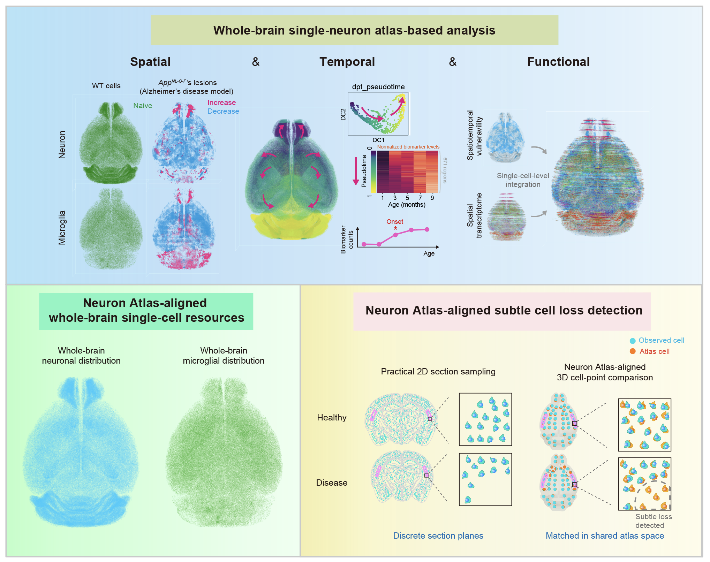

<p align="center">
  
</p>

# Neuron Atlas Analysis
This repository provides the source code and analysis notebooks for whole-brain-scale single-cell analyses of neurons, microglia, and cell nuclei detected from cleared mouse brains imaged by **10x** (`d-MOVIE`) and **1x** light-sheet fluorescence microscopy. We perform single-cell-level registration to the **Neuron Atlas** (51,614,573 neuron points) and implement:
- Whole-brain regional and single-cell statistical evaluation
- Pathological pseudotime and onset ordering analysis
- 3D vs. 2D histological sampling recall validation
- Spatial transcriptome integration and single-cell-level neuron–microglia risk analysis

## Data Specifications
- **Voxel resolution:** 0.65 × 0.65 × 2.5 µm (xyz, 10× cellular imaging)
- **ROI size:** 2048 × 2060 (effective 2048 × 2048)
- **Bit depth:** 16-bit grayscale images
- **Channels:** Neurons (`anti-NeuN`), Microglia (`anti-Iba1`), Cell nuclei (`BOBO-1`)
- **Data volume:** ~15 TB per whole brain (3 channels; >1 PB across all raw whole-brain stacks)
- **Imaging protocol:** Adapted from [Matsumoto K, et al., *Nature Protocols* (2019)](https://www.nature.com/articles/s41596-019-0240-9). Dorsal (FW) and ventral (RV) Z-stacks are acquired with overlap and stitched in 3D prior to atlas registration.

## Publicly Available Atlas & Processed Datasets
All processed Neuron Atlas templates, anatomical/pGM/pWM masks, digitized single-cell coordinates, Aβ plaque coordinates, and statistical output maps are publicly available via:
- **Direct Download:** [Google Drive (`Neuron_Atlas` / `pGM_and_pWM_masks` / `Analyzed_cell_distribution_data` / `Results_of_Statistical_Analysis_of_Cell_Distributions`)](https://drive.google.com/drive/folders/1XrRgaWScrQQk3uV722mXu4JfQgIKu4IZ) (and archived in the EMBL-EBI BioImage Archive accompanying the publication).

### Directory Structure of Deposited Data
1. **Available Atlas Data (`/Neurology/Neuron_Atlas/` & `/Neurology/pGM_and_pWM_masks/`):**
   - **Neuron Atlas cell data** (`xyz` coordinates, cell-type classifications, Allen Brain Atlas annotation IDs): `Neuron_Atlas/SCA_Cellome_data_original.bin` and `Neuron_Atlas/CUBIC-R_Atlas_8w_1_without_NeuN_ver4.csv.gz`
   - **Averaged 50 µm density template images** compatible with Allen Brain Atlas CCFv3 (10 µm annotation scale): `Neuron_Atlas/iso_50um_R_ver4_nuclear_with_ventricle.tif`, `Neuron_Atlas/iso_50um_R_ver4_nuclear.tif`, and `Neuron_Atlas/iso_50um_R_ver4.tif`
   - **pGM / pWM masks & distance maps** (practical gray matter and practical white matter defined by local neuron ratio at 10 µm scale): `pGM_and_pWM_masks/`
2. **Available Digitized Single-Cell & Aβ Cohort Data (`/Neurology/Analyzed_cell_distribution_data/`):**
   - Contains 18 experimental cohorts (`WT_1m`, `WT_2m`, `WT_3m`, `WT_5m`, `WT_7m`, `WT_9m`, `WT_12m`; `APP_1m`, `APP_3m`, `APP_5m`, `APP_7m`, `APP_9m`; `Saline_2m`, `TMT_2m`; `VCP_WT_2m`, `VCP_mut_2m`; `newVCP_WT_2m`, `newVCP_mut_2m`), including post-digitization single-cell coordinate/intensity files (e.g., `WT_1m/#4_APPmodel_Ctr1m_1_2022_1104_1550/` with reference raw `.bin` planes `200000.bin–200500.bin` under `/172000/172000_176260/`) and Aβ plaque extractions (e.g., `APP_9m/#4_APPmodel_Abeta_APP9m_1/`).
3. **Statistical Analysis Outputs (`/Neurology/Results_of_Statistical_Analysis_of_Cell_Distributions/`):**
   - Regional and single-cell regression, onset, and risk-analysis binary/tabular outputs across all cohorts.
4. **Sample & Region Metadata (`Supplementary Table 1.xlsx`):**
   - Provided in the root of this repository (`Supplementary Table 1.xlsx`) and in the manuscript Supplementary Information.

> **Note on raw >1 PB light-sheet stacks:** Because raw un-cropped 3-channel 10× whole-brain light-sheet image stacks (~15 TB per brain; >1 PB total) exceed public repository capacity, raw stacks are preserved on institutional storage and available from the corresponding author upon reasonable request.

---

## System Requirements & Software Versions
### Operating Systems & Hardware
- **Tested Linux environments:**
  - **CentOS Linux release 7.9.2009 (Core)** (`x86_64`) with Python `3.6.8` or `3.9.0` (virtualenv)
  - **Ubuntu 22.04.4 LTS** (`x86_64`) with Python `3.7.17` or `3.9.19` (virtualenv)
- **Light-sheet acquisition workstation:** Windows (`x86_64`) with **Microsoft Visual Studio 2019** (data collection control)
- **Non-standard hardware requirements:**
  - **NVIDIA CUDA-capable GPU** (required for Step `1.1.1–1.1.2` 3D Hessian-based Difference of Gaussians [`HDoG3D`] GPU segmentation in `src/3D/`)
  - **Multi-core x86_64 workstation** (`>=64 GB` RAM recommended when loading whole-brain ~50M single-cell binary arrays; lightweight regional statistical notebooks run on a standard desktop computer with `16 GB` RAM)

### Software Dependencies & Version Numbers
- **Core Languages & Build Tools:**
  - **Python:** `3.6.8`, `3.7.17`, `3.9.0`, or `3.9.19`
  - **R:** `3.6.0` (packages: `pdfCluster` [`1.0-4`, CRAN `doi:10.32614/cran.package.pdfcluster`], `MASS` [`7.3`])
  - **C++ / CUDA Build:** `CMake >= 2.8` (`3.16+` recommended), NVIDIA `CUDA Toolkit` (`10.x`–`11.x`), upstream base framework [`CUBIC-informatics`](https://github.com/lsb-riken/CUBIC-informatics)
- **External Registration, Imaging & Validation Software:**
  - **ANTs (Advanced Normalization Tools):** `2.3.x` (and Python interface `antspyx` `0.3.x`–`0.4.x`)
  - **ImageJ / Fiji:** `1.53`–`1.54` (with `PSFj` and `BioBeam` plugins for optical evaluation)
  - **Imaris (Oxford Instruments / Bitplane):** `9.x` (3D volume rendering)
  - **Image Lab (Bio-Rad):** `6.1` (immunoblot acquisition/quantification)
  - **Microsoft Excel:** `Microsoft 365 / 2021` (Source Data workbook formatting)
- **Python Packages (tested compatible ranges across Python `3.6.8`–`3.9.19`):**
  - Core numerical/scientific: `numpy` (`1.19`–`1.26`), `scipy` (`1.5`–`1.11`), `pandas` (`1.1`–`2.1`), `statsmodels` (`0.12`–`0.14`), `scikit-learn` (`0.24`–`1.3`), `joblib` (`1.0`–`1.3`), `lmfit` (`1.0`–`1.2`), `ruptures` (`1.1`)
  - Bioimage & registration: `tifffile` (`2020.9`–`2023.7`), `SimpleITK` (`2.0`–`2.3`), `scikit-image` (`0.17`–`0.21`), `opencv-python` (`4.5`–`4.8`), `Pillow` (`8.0`–`10.0`), `nibabel` (`3.2`–`5.1`), `skan` (`0.9`–`0.11`), `stardist` (`0.8.x`) & `csbdeep` (`0.7.x`)
  - Spatial transcriptomics & visualization: `scanpy` (`1.7`–`1.9`), `anndata` (`0.7`–`0.9`), `umap-learn` (`0.5`), `matplotlib` (`3.3`–`3.8`), `seaborn` (`0.11`–`0.13`), `statannotations` (`0.4`–`0.6`), `adjustText` (`0.7`–`0.8`), `rpy2` (`3.4`–`3.5`), `natsort`, `docopt`, `tqdm`

---

## Installation Guide
1. Clone the upstream [`CUBIC-informatics`](https://github.com/lsb-riken/CUBIC-informatics) repository and set up the Python/R environment (`virtualenv` or Docker).
2. Clone this repository and copy `/src/`, `/param/`, `/script/`, and `/Abeta_analysis/` over the `CUBIC-informatics` workspace, then compile `src/3D/` (`HDoG3D_NeuN_ver3_Rank_simple_3_color`) with CMake + CUDA.
3. For running downstream registration, statistical, and revision notebooks (`Steps 1.1.5–11` and `script/revision_2026/`) directly from the deposited processed datasets, no GPU compilation is required—only the Python `3.7–3.9` and R `3.6.0` packages above.

- **Typical installation time:** Approximately **30 minutes** on a standard workstation.

---

## Demo & Expected Output
1. **Demo input dataset:** Download `Neuron_Atlas/`, `pGM_and_pWM_masks/`, and the reference brain folder `Analyzed_cell_distribution_data/WT_1m/#4_APPmodel_Ctr1m_1_2022_1104_1550/` (which includes reference raw `.bin` planes `200000.bin–200500.bin` and post-HDoG candidate tables), paired with the repository parameter directory `param/Neuronomics/#4_APPmodel_Ctr1m_1_2022_1104_1550/`.
2. **How to run the demo:**
   - Run Steps `(1.1.1)–(1.1.11)` and `(2)` below using `param/Neuronomics/#4_APPmodel_Ctr1m_1_2022_1104_1550/` to execute candidate classification, stitching, 50 µm nuclear/neuron density generation, `pdfCluster` cell-type classification, and registration to the Neuron Atlas.
   - Run Steps `(4)–(11)` and `script/revision_2026/*.ipynb` on the deposited `Results_of_Statistical_Analysis_of_Cell_Distributions/` tables to reproduce regional/single-cell statistical figures.
3. **Expected output:**
   - Stitched 3D cell coordinate & intensity binaries, `50 µm` voxel nuclear/neuron density `.tif` volumes aligned to `iso_50um_R_ver4*.tif`, `pdfCluster` decision threshold plots & classified cell tables (`NeuN+`, `Iba1+`, non-neuronal), Allen CCFv3 / Neuron Atlas region-annotated cell counts, and statistical summary tables/plots matching the manuscript figures.
4. **Expected runtime:** Approximately **5 hours** in total for the full single-brain pipeline demo (`Steps 1–2`); individual downstream statistical and `script/revision_2026/` notebooks complete in **2–20 minutes** on a standard desktop computer.

---

## Main Pipeline Steps
### 1. Data Processing
#### 1.1 Cell Digitization (10× high-resolution light-sheet imaging data)
**(1.1.1) GPU-based cell candidate segmentation (Dorsal / FW side)**  
Based on a modified HDoG filter approach from Matsumoto K, et al., *Nature Protocols* (2019) ([CUBIC-informatics](https://github.com/lsb-riken/CUBIC-informatics)), `HDoG3D_NeuN_ver3_Rank_simple_3_color.cpp` incorporates local min–max normalization for neuron and microglia channels.
```bash
docker compose run dev python script/HDoG_gpu.py \
  param/Neuronomics/#4_APPmodel_Ctr1m_1_2022_1104_1550/param_HDoG_FW.json \
  --exec build/src/3D/HDoG3D_NeuN_ver3_Rank_simple_3_color
```
**(1.1.2) GPU-based cell candidate segmentation (Ventral / RV side)**
```bash
docker compose run dev python script/HDoG_gpu.py \
  param/Neuronomics/#4_APPmodel_Ctr1m_1_2022_1104_1550/param_HDoG_RV.json \
  --exec build/src/3D/HDoG3D_NeuN_ver3_Rank_simple_3_color
```
**(1.1.3) Merge Local to Global Coordinates**
```bash
python script/MergeBrain_NeuN.py full \
  param/Neuronomics/#4_APPmodel_Ctr1m_1_2022_1104_1550/param_merge.json
```
**(1.1.4) Cell Nuclei Classification**
```bash
python script/HDoG_classifier_NeuN.py \
  param/Neuronomics/#4_APPmodel_Ctr1m_1_2022_1104_1550/param_classify.json
```
**(1.1.5) Image and Cell Point Stitching**  
Template-matching stitching applied to 3D cell coordinates (further detailed in [Yoshida SY, et al., *Cell* (2026)](https://doi.org/10.1016/j.cell.2025.12.057)).
- **Notebook:** `script/stitching_2023/1-1-5_Robust_stitching.ipynb`

**(1.1.6) Creating a 50 µm Voxel Cell Nuclear Density Image**
- **Notebook:** `script/1-1-6_Stitched_50um_image_making.ipynb`

**(1.1.7) Cell-Nuclear-Density-Based Whole-Brain Registration to Raw Neuron Atlas Space (Initial)**
```bash
python script/AtlasMapping_stitched_initial_annotation_all.py annotation \
  param/Neuronomics/#4_APPmodel_Ctr1m_1_2022_1104_1550/param_mapping_R.json -p 20
```
**(1.1.8) Rank Filter Normalization**
```bash
python script/MultiChannelVerification-rank-simple-dsb.py \
  param/Neuronomics/#4_APPmodel_Ctr1m_1_2022_1104_1550/param_multichannel-rank.json -p 5
```
**(1.1.9) pdfCluster-Based Cell Type Classification**
- **Notebook:** `script/1-1-9_pdfCluster.ipynb`

**(1.1.10) Creating a 50 µm Voxel Neuron Density Image**
- **Notebook:** `script/1-1-10_Neuron_50um_image_making.ipynb`

**(1.1.11) Neuron-Cell-Density-Based Whole-Brain Registration to Raw Neuron Atlas Space**  
(Use a distinct output directory from Step 1.1.7 to avoid overwriting initial nuclear registration.)
- **Notebook:** `script/1-1-11_Registration_to_the_raw_Neuron_Atlas_using_Neuron_density_image.ipynb`

#### 1.2 Aβ Deposition Extraction (1× macroscopic light-sheet imaging data)
- **Notebook:** `Abeta_analysis/1-2_Abeta_extraction.ipynb` (following Yanai et al., *Brain Communications* 2024; [`Tau-analysis`](https://github.com/OrganismalSystemsBiology/Tau-analysis.git))

#### 2. Cell Points Registration and Anatomical Annotation (Allen Brain Atlas CCFv3)
- **Notebook (Cell types):** `script/2_SCA_registration_and_annotation.ipynb`
- **Notebook (Aβ):** `Abeta_analysis/2_Abeta_data_registration_to_Neuron_Atlas.ipynb`

### Advanced & Manuscript Figure Analyses (`Steps 3–11`)
3. **Local cell density consistency after registration:** `script/3_local_cell_density_consistency.ipynb`
4. **Whole-brain regional plots:** `script/4_Whole_brain_regional_plots.ipynb`
5. **Age-dependent linear regression analysis:**
   - Regional: `script/5-1_Regional_Age-dependent_linear_regression_analysis.ipynb` (with R scripts `script/R_code_glmnb_age.R`, `script/R_code_lire_age.R`)
   - Single-cell: `script/5-2_Sigle_Cell_level_Age-dependent_linear_regression_analysis.ipynb`
6. **Single-cell onset & spatiotemporal neuron–microglia risk analysis:** `script/6_Sigle_Cell_level_Onset_analysis_and_Spatiotemporal_Neuron_Microglia_risk_analysis.ipynb`
7. **Pathological pseudotime analysis:**
   - Aβ & Thal-like staging: `script/7-1_Aβ_Pathological_pseudotime_analysis_and_Thal phase analysis.ipynb`
   - Microglia: `script/7-2_microglial_Pathological_pseudotime_analysis.ipynb`
   - Microgliosis (NND): `script/7-3_microgliosis(NND)_Pathological_pseudotime_analysis.ipynb`
8. **Spatial density variation (3D vs. 2D) & biomarker 2D recall regression:** `script/8_3D_vs_2D_analysis.ipynb`
9. **Microglial 3D morphology (`skan`) & microgliosis analysis:** `script/9_Microglial_3D_morphology_and_microgliosis_analysis.ipynb`
10. **Microglial spatial gradient masks using pGM/pWM distance maps:** `script/10_Microglial_spatial_gradient_making.ipynb`
11. **Spatial single-cell risk & spatial transcriptome integration:** `script/11_Transcriptomical_Neuron_Microglia_risk_analysis.ipynb`  
    Integrates public spatial transcriptomics from [Shi et al., *Nature* (2023)](https://www.nature.com/articles/s41586-023-06569-5) ([Single Cell Portal `SCP1830`](https://singlecell.broadinstitute.org/single_cell/study/SCP1830); [Zenodo `10.5281/zenodo.8327576`](https://doi.org/10.5281/zenodo.8327576); [`mCNS-atlas`](https://github.com/wanglab-broad/mCNS-atlas)).

---

## Peer-Review Validation Analyses (`script/revision_2026/`)
Notebook filenames retain their historical peer-review IDs; the table maps each notebook to both the **final *Nature* publication display item (Plan A: 6 Main + 13 Extended Data + 30 Supplementary Figures)** and the **10/7 revised submission figure number**:

| Notebook (`script/revision_2026/`) | Analysis | Final *Nature* Display Item | 10/7 Revision Item |
|---|---|---|---|
| `ED5_3D_IHC_vs_2D_ST_spatial_comparison.ipynb` | Spatial comparison of 3D IHC vs. 2D ST distributions for PV/ChAT/TH (NND; odds ratio) | Supplementary Fig. 4b,c | Ext. Data Fig. 5b,c |
| `ED18_permutation_validation_fibertract_layer6b.ipynb` | Permutation validation of fiber-tract / cortical layer-6b neuronal decrease | Extended Data Fig. 8b,d | Ext. Data Fig. 18b,d |
| `ED19_registration_consistency_NCC.ipynb` | Registration consistency (NCC within eroded global tissue mask; Levene's test) | Supplementary Fig. 13a,b | Ext. Data Fig. 20a,b |
| `ED19_raw_vs_atlas_corrected_volume.ipynb` | Raw vs. atlas-corrected regional volume and effect on neuronal-density detection | Supplementary Fig. 13c,d | Ext. Data Fig. 20c,d |
| `ED20_StarDist_segmentation_validation.ipynb` | Independent 3D StarDist segmentation validation (F1 vs. manual ground truth) | Supplementary Fig. 14b–d | Ext. Data Fig. 21b–d |
| `ED22_MAP2_2D_physical_section.ipynb` | MAP2-dropout detection on 2D physical sections, *App* vs. WT density, and enrichment | Extended Data Fig. 10d,e | Ext. Data Fig. 24d,e |
| `ED23cd_neuronal_count_and_power_analysis.ipynb` | Normalized NeuN+ counts (WT vs. *App*) and required-sample-size power analysis | Supplementary Fig. 17c,d | Ext. Data Fig. 25c,d |
| `ED24_optical_to_physical_section_mapping.ipynb` | Same-brain optical-to-physical section correspondence (registration, cell assignment, NCC) | Supplementary Fig. 18 | Ext. Data Fig. 26 |
| `ED26-28_2D_multisection_sampling_recall.ipynb` | Practical 2D sampling: density correlation, CV, ≤10% error, 2D recall, recall–CV regression | Extended Data Fig. 11 & Supplementary Figs. 20–21 | Ext. Data Figs. 28–30 |
| `ED29_effectsize_neuronal_decrease.ipynb` | Effect-size distribution of *App*-specific neuronal decrease | Supplementary Fig. 22a,b | Ext. Data Fig. 31a,b |
| `ED31_microglia_redistribution_2D_physical.ipynb` | Microglial redistribution validated on 2D physical serial sections | Supplementary Fig. 24a–c | Ext. Data Fig. 33a–c |

Reference datasets for PV, ChAT, and TH used in `ED5_3D_IHC_vs_2D_ST_spatial_comparison.ipynb` are publicly downloadable from the [CUBIC-Atlas Portal](https://cubic-atlas.dspdb.systems-based-medicine.org/) (migrated from `http://cubic-atlas.riken.jp`).

---

## License & Citation
This software is released under the **MIT License** (see [`LICENSE`](LICENSE)).

If you use this code or the deposited Neuron Atlas datasets, please cite:
- **Article:** Mitani, T.T. *et al.* Whole-brain single-neuron atlas reveals a microglial security-hole pattern. *Nature* (in press; preprint: https://doi.org/10.21203/rs.3.rs-5827312/v1).
- **Archived Code (Zenodo):** Mitani, T.T. *et al.* `OrganismalSystemsBiology/Neuron-atlas-analysis` (v1.0.0). *Zenodo* *(DOI minted automatically upon v1.0.0 GitHub Release)*.
